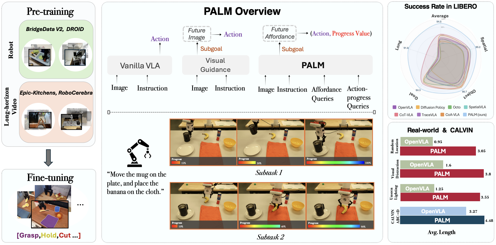

## $\color{orange}{\textbf{{[CVPR 2026]}}}$ PALM: Progress-Aware Policy Learning via Affordance Reasoning for Long-Horizon Robotic Manipulation

<div align="center">

<p align="center">
  <a href="https://plan-lab.github.io/projects/palm/"></a>
  <a href="https://arxiv.org/abs/2601.07060"></a>
  <a href="https://huggingface.co/PLAN-Lab/PALM"></a>
  <a href="https://www.youtube.com/watch?v=0K4wl7nW7no"></a>
</p>


</div>

## 🔥 Highlights

<p align="center">
  
</p>

- 🤖 **Unified VLA framework:** PALM couples affordance reasoning with subtask progress estimation.

- 🎯 **Structured affordance reasoning:** PALM predicts future interaction cues for object relevance, contact, placement, and motion.

- 🏆 **Strong long-horizon results:** PALM achieves state-of-the-art performance on CALVIN ABC-D and LIBERO-LONG, with robust real-world generalization.


## 🌟: Installation

### Environment Setup

Create and activate conda environment:
```bash
conda create -n palm python=3.10 -y
conda activate palm
```

Install PyTorch:
```bash
pip install torch==1.13.1+cu117 torchvision==0.14.1+cu117 torchaudio==0.13.1+cu117 --extra-index-url https://download.pytorch.org/whl/cu117
```

Install dependencies:
```bash
pip install git+https://github.com/openai/CLIP.git
pip install -r requirements.txt
```


## 🌟: PALM Framework

<p align="center">
  
</p>


## 🌟: Getting Started
We provide step-by-step guidance for running PALM in simulations and real-world experiments.
Follow the specific instructions for a seamless setup.

### Simulation <a name="simulation"></a>
#### CALVIN ABC-D <a name="calvin abc-d"></a>
- [Installation](docs/CALVIN_ABC-D_INSTALL.md)
- [Running Code](docs/CALVIN_ABC-D_RUN.md)
#### LIBERO <a name="libero long"></a>
- [Installation](docs/LIBERO_INSTALL.md)
- [Running Code](docs/LIBERO_RUN.md)
### Real-World<a name="real-world"></a>
#### Real-World (Quick Training w & w/o pre-training)<a name="real-world-qs"></a>
For users aiming to train PALM from scratch or fine-tune it, we provide comprehensive instructions for environment setup, downstream task data preparation, training, and deployment.
- [Installation](docs/REAL-WORLD_INSTALL.md)
- [Fine-tuning & Scratch](docs/REAL-WORLD_FT_SC.md)
- [Inference](docs/REAL-WORLD_INFERENCE.md)

#### Real-World (Pre-training)<a name="real-world-fv"></a>
This section details the pre-training process of PALM in real-world experiments, including environment setup, dataset preparation, and training procedures. Downstream task processing and fine-tuning are covered in [Real-World (Quick Training w & w/o pre-training)](#real-world-qs).
- [Installation](docs/REAL-WORLD_INSTALL.md)
- [Pre-training](docs/REAL-WORLD_PRETRAIN.md)


## 🌟: Checkpoints
Relevant checkpoints are available on [Google Drive](https://drive.google.com/drive/folders/1o8pFqX8MyVhs58ZiFtQdplUr4VL_-FX_?usp=sharing).


## 🌟: Citation <a name="citation"></a>
If you find the project helpful for your research, please consider citing our paper:
```bibtex
@inproceedings{liu2026palm,
  title={PALM: Progress-Aware Policy Learning via Affordance Reasoning for Long-Horizon Robotic Manipulation},
  author={Liu, Yuanzhe and Zhu, Jingyuan and Mo, Yuchen and Li, Gen and Cao, Xu and Jin, Jin and Shen, Yifan and Li, Zhengyuan and Yu, Tianjiao and Yuan, Wenzhen and Ding, Fangqiang and Lourentzou, Ismini},
  booktitle={Proceedings of the IEEE/CVF Conference on Computer Vision and Pattern Recognition},
  year={2026}
}
```
